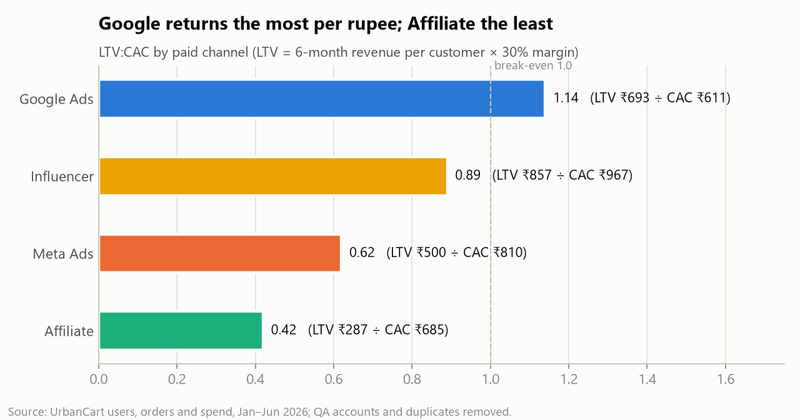
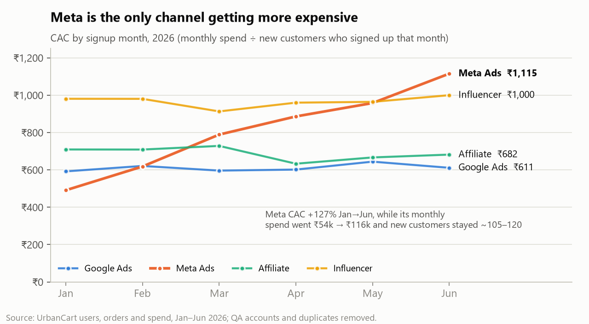
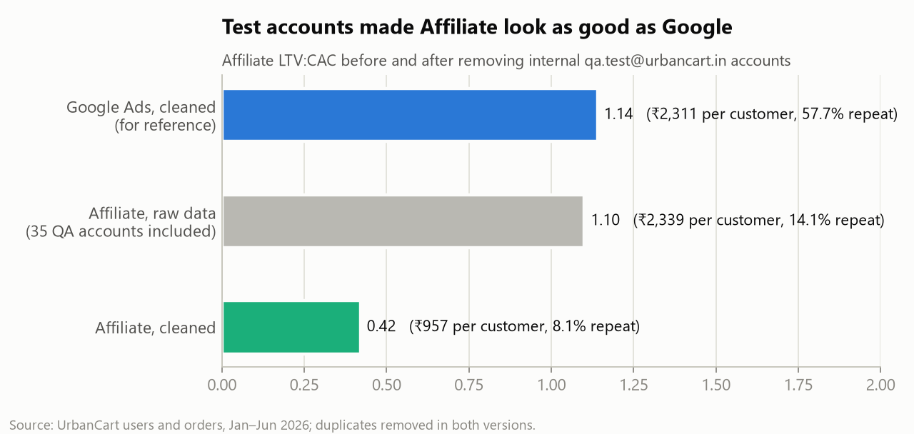

# Memo: Where to cut 20% of paid spend

**To:** CMO · **From:** Data & AI Engineering · **Data:** Jan–Jun 2026, cleaned

**Decision: cut ₹1.74L per quarter (20% of the Q2 run-rate of ₹8.68L), all of it from Meta and Affiliate.**

1. **Meta Ads: −₹1.31L (−39%)**, back to its Q1 level of about ₹69k/month. Meta's CAC rose from ₹491 in January to ₹1,115 in June (+127%). The extra ₹1.31L spent in Q2 versus Q1 brought only 17 more customers, about ₹7,700 each.
2. **Affiliate: −₹43k (−25%).** It has the worst LTV:CAC (0.42): customers spend ₹957 and only 8.1% buy again (Google: 57.7%). The raw data showed Affiliate at 1.10 only because it included 35 internal test accounts (chart 3).

**Protect Google Ads.** It has the best return (LTV:CAC 1.14), and its CAC stayed between ₹592 and ₹644 every month. It gets first claim on any future budget. **Hold Influencer:** its CAC is high (₹967), but its customers are the most valuable (₹2,858 each, 73% repeat).

**Expected impact:** about 83 fewer new customers per quarter (−8% of paid), if Meta's lost customers follow its Q1→Q2 marginal rate. The worst case, at average CAC, is 199 (−18%).

**Biggest risk:** single-channel attribution. Meta may drive purchases credited to Google or Organic, so cutting it could quietly shrink those too.

**Watch weekly:** new customers by channel (Meta should hold near 110/month), Google and Organic volumes, and blended CAC. If paid new customers fall more than 10%, restore half of the Meta cut.

