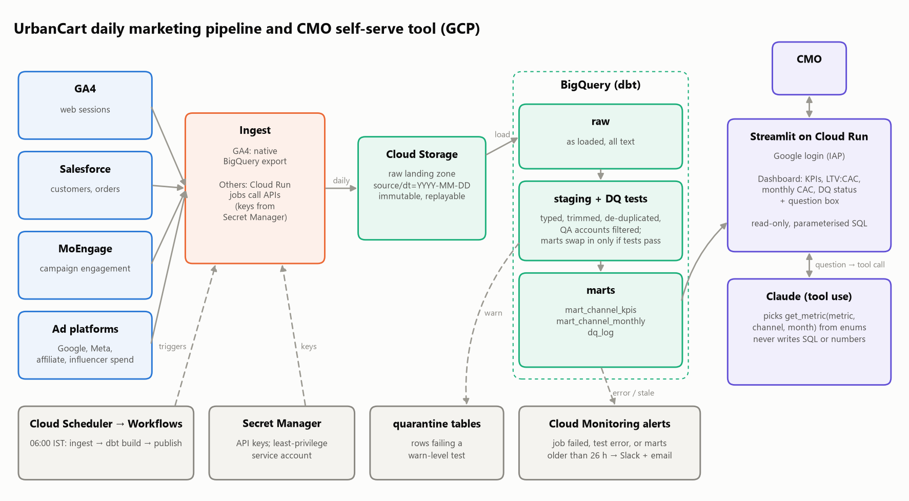

# Part 3: Automate and make it self-serve (design note)

## A. Daily pipeline (GCP)

**Landing and warehouse.** GA4 uses its native BigQuery export. Cloud Run jobs pull Salesforce, MoEngage and the ad platforms into dated, immutable files in `gs://urbancart-raw/<source>/dt=…/`, so any day can be replayed. In **BigQuery**, dbt builds three layers:
- `raw`
- `staging`: typed, trimmed, de-duplicated
- `marts`: `mart_channel_kpis`, `mart_channel_monthly`, using this repo's SQL

**Scheduling.** At 06:00 IST, Cloud Scheduler triggers a Cloud Workflow that runs ingest → `dbt build` (models and tests) → publish. Marts are built into shadow tables and swapped in only after the tests pass.

**Data-quality checks.** The Part 1 issues become dbt tests:
- `unique` order_id (after de-duplication)
- QA accounts filtered via an `internal_domains` seed
- blank channel → `Unknown`, warning above 2%
- accepted statuses; orders → users relationship
- spend for every channel × month
- row counts within ±30% of the 7-day average

Warnings quarantine rows and post to Slack. Errors stop the publish, so yesterday's marts stay live. Results feed a `dq_log` table shown in the dashboard.

**Secrets and alerting.** API keys live in **Secret Manager**, read by a least-privilege service account, never in code. Job failures and stale marts (>26 hours) trigger Cloud Monitoring alerts to Slack and email.

## B. Self-serve tool

A Streamlit app on Cloud Run behind Google login: KPI tiles, LTV:CAC, monthly CAC trend, data-quality status and a question box. It reads **only** `mart_channel_kpis`, `mart_channel_monthly` and `dq_log`.

**From question to answer:**
1. Claude receives the question and one tool, `get_metric(metric, channels, month, mode)`. All arguments are enums.
2. Code validates the arguments against the whitelist and the data range, and refuses anything unsupported.
3. A fixed, parameterised SQL template runs on the mart. The model never writes SQL.
4. Code formats the number. The model only phrases the sentence.
5. The answer shows the number, the SQL and the "data through" date.

**Stopping made-up numbers.** The model never computes. A post-check rejects any reply containing a number not in the query result. Temperature is 0, and unsupported questions get "I can't answer that".

**Testing.**
- A golden set of CMO-style questions with expected answers from Part 1 runs in CI on every prompt, model or SQL change. The target is 100% numeric accuracy and correct refusals.
- Then a one-week shadow run reviewing her real questions.

*Prototype:* `app/streamlit_app.py` runs this flow with a rule-based parser (`src/urbancart/qa.py`) instead of the LLM; golden questions are in `tests/test_qa.py`.
